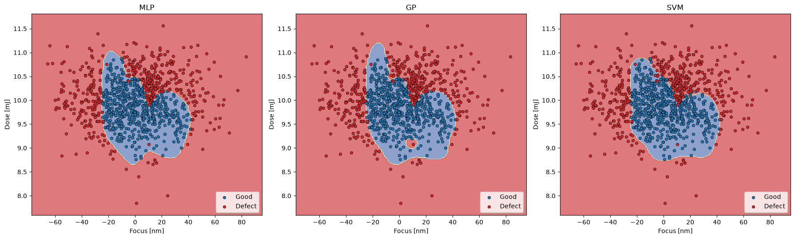

# Lithography Defect Prediction

Predicts whether a die will be defective in a semiconductor lithography process,
using only two process parameters: **focus [nm]** and **exposure dose [mJ]**.
Three classifiers are trained and compared, and their decision boundaries are
plotted over the focus-dose process window.

## Approach

1. **Data**: exposure data and inspection data are cleaned (rows with missing
   values dropped) and inner-joined on `Lot, Wafer, FieldX, FieldY`.
2. **Features / label**: `Focus`, `Dose` -> binary label (0 = good, 1 = defect).
3. **Split**: 80/20 stratified train/test split. The `StandardScaler` is fit on
   the training set only, to avoid test-set leakage.
4. **Models**
   - Multilayer Perceptron (3 hidden layers x 40 neurons)
   - Gaussian Process Classifier (RBF kernel)
   - Support Vector Machine (RBF kernel, `gamma=2`, `C=1`)
5. **Evaluation**: confusion matrix, precision / recall / F1 per model, plus
   decision-boundary plots in original focus/dose units.

## Results

Results are saved to `results/` after a run:

| File | Content |
|------|---------|
| `metrics.csv` | Accuracy and defect-class precision / recall / F1 per model |
| `decision_boundaries.png` | Decision boundary of each model over the data |
| `raw_data.png` | Raw good vs. defective samples in the focus-dose plane |

Test-set performance (20% stratified hold-out), defect class = positive:

| Model | Accuracy | Defect Precision | Defect Recall | Defect F1 |
|-------|----------|------------------|---------------|-----------|
| MLP   | 0.950    | 0.943            | 0.943         | 0.943     |
| GP    | **0.960**| 0.944            | **0.966**     | **0.955** |
| SVM   | 0.950    | 0.933            | 0.955         | 0.944     |

The Gaussian Process classifier performed best, with the highest accuracy,
defect recall and F1. The differences between models are small (about 1
percentage point), so on a test set of this size they should not be
over-interpreted.



## Usage

```bash
pip install -r requirements.txt

# put the CSV files in ./data (or pass your own paths)
python litho_defect_prediction.py \
    --exposure data/exposure_data.csv \
    --inspection data/inspection_data.csv \
    --out results
```

## Project structure

```
.
├── litho_defect_prediction.py   # full pipeline (load, train, evaluate, plot)
├── requirements.txt
├── README.md
├── data/                        # exposure_data.csv, inspection_data.csv (not included)
└── results/                     # generated metrics and plots
```

## Notes

- Feature and label columns are detected by name (`focus`, `dose`, `label`),
  with positional fallbacks if the names differ.
- The data files are not included in this repository.
- Possible extensions: hyperparameter tuning with `GridSearchCV`, k-fold
  cross-validation, and adding more process parameters as features.
